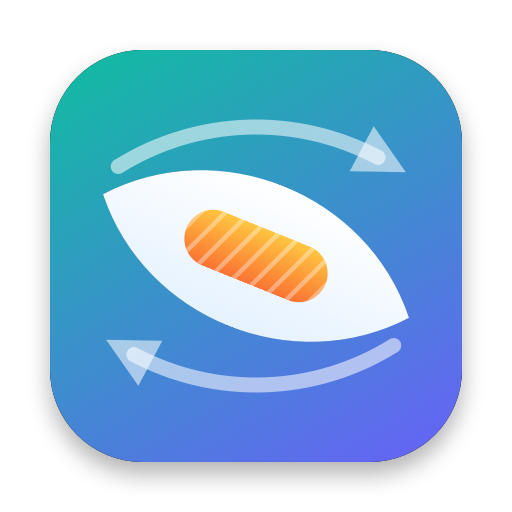
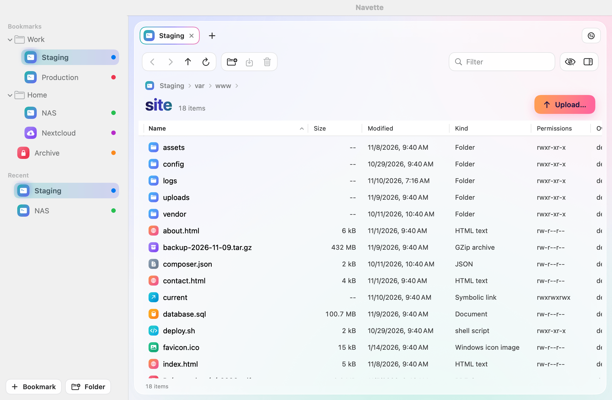
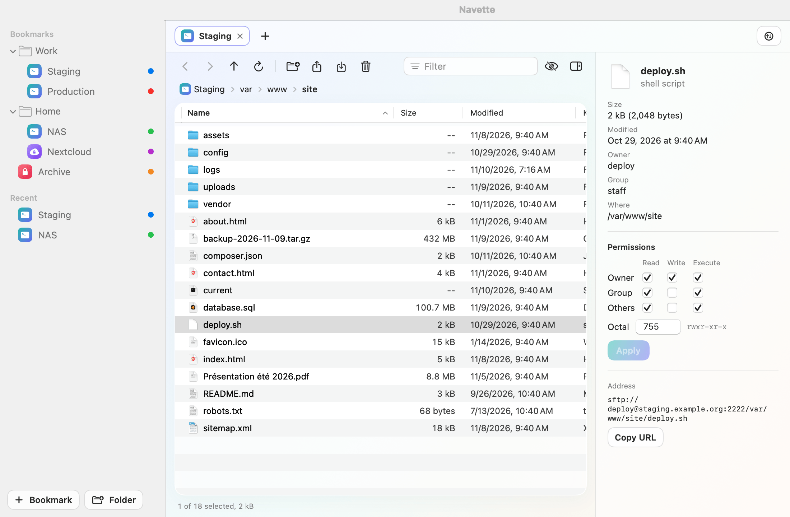
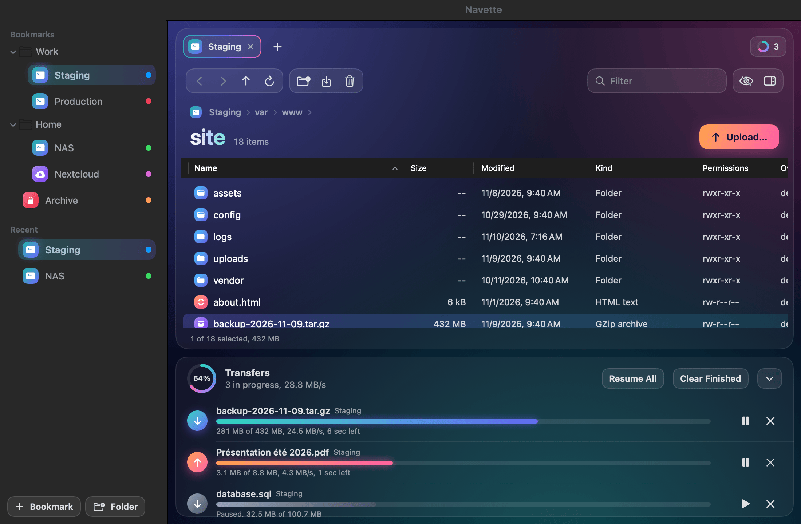
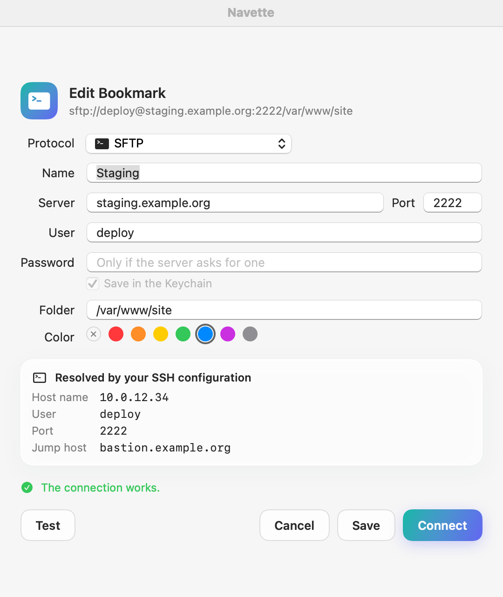
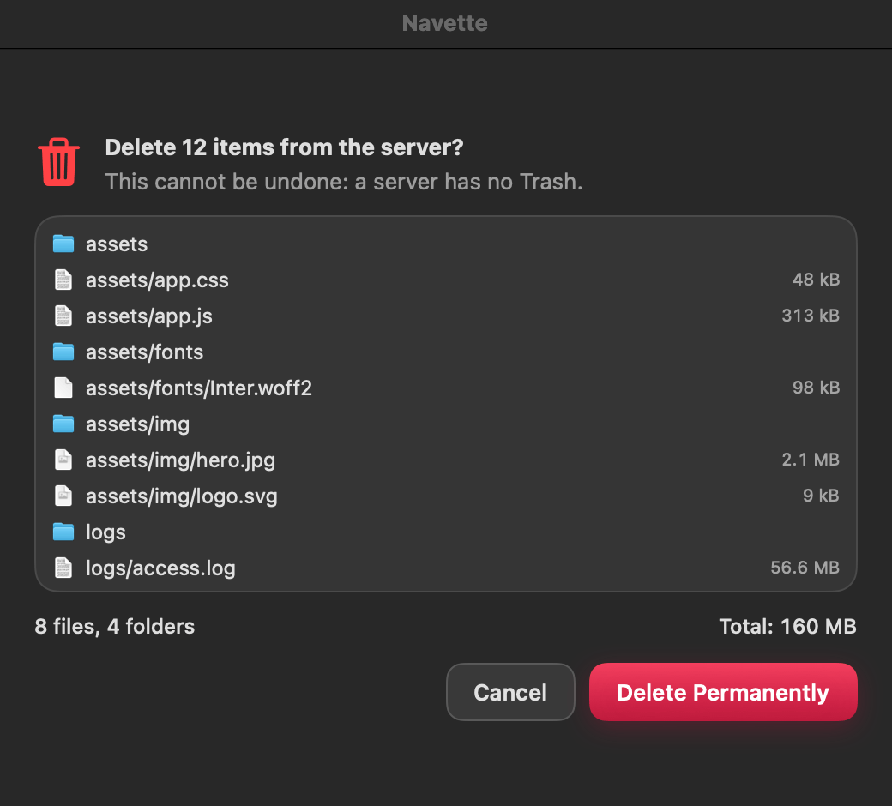

<p align="center">
  
</p>

<h1 align="center">Navette</h1>

<p align="center">
  <strong>Un client de transfert de fichiers gratuit et open source pour macOS.</strong><br>
  SFTP, FTP, FTPS et WebDAV dans une app native qui reste rapide, respecte votre configuration SSH<br>
  et ne supprime ni n'écrase jamais rien que vous n'ayez vu.
</p>

<p align="center">
  <a href="https://github.com/romainrg/Navette/releases/latest"></a><br>
  <sub>Gratuit et open source · macOS 14 ou ultérieur · Apple silicon et Intel</sub>
</p>

<p align="center">
  <a href="https://github.com/romainrg/Navette/actions/workflows/ci.yml"></a>
  <a href="https://github.com/romainrg/Navette/releases/latest"></a>
  
  <a href="LICENSE"></a>
</p>

<p align="center"><a href="README.md">English version</a></p>

Navette est écrite en Swift et SwiftUI, pèse environ 10 Mo, n'a aucune dépendance tierce et n'envoie aucune donnée d'utilisation. C'est la troisième app d'une petite famille, après [Mopster](https://github.com/romainrg/Mopster) et Copicol.

> **État : 0.1, une première version.** Les pilotes de protocoles et le moteur de transfert sont couverts par des tests automatiques contre de vrais serveurs locaux. L'interface n'a été vérifiée pour l'instant que sur des captures rendues : voir les [limites connues](#limites-connues).



## Fonctionnalités

- **Navigateur de fichiers** : colonnes triables, barre de chemin, filtre, fichiers cachés, onglets (un par connexion), inspecteur.
- **Transferts** : une file avec progression, débit et temps restant ; pause, reprise, relance et annulation ; limite de débit ; plusieurs transferts simultanés par serveur.
- **Conflits explicites** : quand un fichier existe déjà, vous choisissez entre écraser, reprendre, renommer et ignorer, une fois ou pour tout le transfert.
- **Glisser-déposer** : déposez des fichiers et des dossiers depuis le Finder pour les envoyer ; glissez depuis la liste vers le Finder pour les télécharger.
- **Favoris** avec dossiers et couleurs, connexions récentes, mots de passe dans le Trousseau.
- **Connexion rapide** : collez `sftp://user@host:2222/chemin` et vous y êtes.
- **Coup d'œil** sur les fichiers distants (barre d'espace), et **Ouvrir avec** : modifiez un fichier distant dans votre éditeur, chaque enregistrement est renvoyé.
- **Permissions** : cases à cocher et octal, appliquées si vous le voulez à tout le contenu d'un dossier.
- **Anglais et français.**

| | |
|---|---|
|  |  |
|  |  |

## Protocoles

| Protocole | Comment | Remarques |
|---|---|---|
| **SFTP** | Le `ssh` du système, avec SFTP par-dessus | Tout `~/.ssh/config` fonctionne : alias, `Port`, `ProxyJump`, `IdentityFile`, certificats, agents (ssh-agent, 1Password, Secretive), clés FIDO, `known_hosts` |
| **FTP** | Network.framework | Non chiffré : Navette le signale |
| **FTPS** | TLS explicite (`AUTH TLS`), implicite sur le port 990 | Ne repasse jamais en clair |
| **WebDAV** | URLSession, http et https | Préréglages Nextcloud et ownCloud |

S3 et les services compatibles, le double panneau et la synchronisation de dossiers sont prévus pour la 0.2 : voir la [feuille de route](#feuille-de-route).

### SSH, comme dans votre terminal

Navette ne contient pas d'implémentation de SSH. Elle lance `/usr/bin/ssh` et le laisse faire ce qu'il fait déjà pour vous dans Terminal. La fiche de connexion affiche ce que votre configuration résout (nom d'hôte réel, utilisateur, port, clés, hôte de rebond) avant de vous connecter. Quand `ssh` a besoin d'un mot de passe, d'une phrase de passe, d'un code à usage unique ou de votre décision sur une nouvelle clé d'hôte, Navette affiche la question dans une feuille.

## Ce que Navette ne fait jamais

- **Supprimer sur un serveur sans montrer la liste.** Un serveur n'a pas de Corbeille. Avant une suppression distante, Navette liste tout ce que contient la sélection, avec le nombre d'éléments et la taille totale, et supprime exactement cette liste.
- **Supprimer définitivement sur votre Mac.** Un fichier local remplacé par un téléchargement va dans la Corbeille.
- **Accepter une clé d'hôte SSH qui a changé.** Elle explique ce qui s'est passé et comment corriger ; `known_hosts` reste le vôtre.
- **Contourner en silence une erreur de certificat.** Vous voyez d'abord le certificat, et l'approuver ne vaut que pour ce certificat précis sur ce serveur.
- **Laisser un fichier à moitié écrit à la place d'un bon.** Les envois et les téléchargements passent par un nom temporaire et sont renommés une fois leur taille vérifiée. Un transfert annulé ne laisse rien derrière lui.
- **Réécrire un nom de fichier.** Accents, emoji, espaces et guillemets voyagent octet pour octet, dans les deux sens.
- **Suivre un lien symbolique hors de votre sélection** quand elle supprime ou télécharge un dossier.
- **Appeler la maison.** Navette contacte les serveurs que vous configurez et rien d'autre.

## Installation

1. Téléchargez `Navette-<version>.dmg` depuis la [dernière version](https://github.com/romainrg/Navette/releases/latest) et ouvrez-le. Un installeur `.pkg` s'y trouve aussi.
2. Glissez **Navette** sur le dossier **Applications**, éjectez l'image disque, puis ouvrez Navette depuis `Applications`.
3. Navette n'est pas encore notarisée par Apple : macOS bloque donc le premier lancement. Ouvrez **Réglages Système › Confidentialité et sécurité**, descendez et cliquez sur **Ouvrir quand même** à côté du message concernant Navette. Ou bien lancez :

   ```sh
   xattr -dr com.apple.quarantine /Applications/Navette.app
   ```

Chaque version est accompagnée d'un fichier `SHA256SUMS` : `shasum -a 256 -c SHA256SUMS` vérifie votre téléchargement.

Les builds étant signées ad hoc, macOS redemande une fois l'accès à l'élément Navette du Trousseau après chaque mise à jour.

Nécessite macOS 14 ou plus récent, sur Apple Silicon ou Intel.

### Compiler depuis les sources

```sh
brew install xcodegen
make run      # compile et ouvre l'app
make demo     # l'essayer avec des serveurs factices : ni réseau, ni accès disque
```

Xcode 16 ou plus récent est requis.

## Limites connues

- **Testée uniquement par des tests automatiques.** Le glisser-déposer, Coup d'œil, Ouvrir avec, les invites et les serveurs réels doivent encore être essayés à la main.
- **Les serveurs FTPS qui exigent la réutilisation de la session TLS** sur les connexions de données (réglage par défaut de vsftpd et de FileZilla Server) ne sont pas pris en charge : l'API publique d'Apple ne le permet pas. Navette indique quel réglage du serveur est en cause.
- **Les invites de mot de passe et de code à usage unique en SSH**, les clés FIDO et les agents tiers reposent sur `ssh` lui-même et n'ont pas encore été éprouvés sur de vrais serveurs.
- **Ni vue en colonnes, ni découverte Bonjour, ni Quick Open** en 0.1.
- **Glisser à l'intérieur de la liste** pour déplacer des fichiers n'est pas disponible ; utilisez Renommer ou les outils de votre serveur.
- **Les envois WebDAV ne peuvent pas reprendre** ; ils recommencent.
- **Un transfert interrompu en quittant l'app** ne reprend pas au relancement.

## Confidentialité

Navette n'a ni analytics, ni télémétrie, ni vérification de mise à jour. Elle n'ouvre de connexions réseau que vers les serveurs que vous configurez. Les mots de passe et phrases de passe sont stockés dans votre Trousseau, dans un seul élément nommé Navette ; les favoris sont stockés sans aucun secret dans `~/Library/Application Support/Navette/bookmarks.json`.

## Développement

```sh
make test          # tests unitaires, puis vérification que chaque chaîne a sa traduction française
make integration   # les pilotes contre des serveurs locaux démarrés pour l'occasion (sshd, Apache, vsftpd)
make screenshots   # régénère les images de ce README à partir des données de démo
make release       # build universelle, DMG et PKG dans build/release
```

Toute la logique vit dans le paquet `NavetteCore`, sans SwiftUI ni AppKit. Voir [docs/ARCHITECTURE.md](docs/ARCHITECTURE.md), [CONTRIBUTING.md](CONTRIBUTING.md) et, pour les agents de code, [AGENTS.md](AGENTS.md) (en anglais).

## Feuille de route

- **0.2** : S3 et services compatibles (AWS, Cloudflare R2, Backblaze B2, Wasabi, MinIO, Scaleway, OVH, Hetzner), double panneau Mac / serveur, synchronisation de dossiers avec aperçu, import des favoris Cyberduck, Transmit et FileZilla, vue en colonnes, Bonjour, Quick Open.
- **0.3** : Azure Blob, Google Cloud Storage, OpenStack Swift, SMB, coffres Cryptomator.
- **Plus tard** : signature Developer ID et notarisation.

## Licence

[MIT](LICENSE). © 2026 Romain Gallien.
