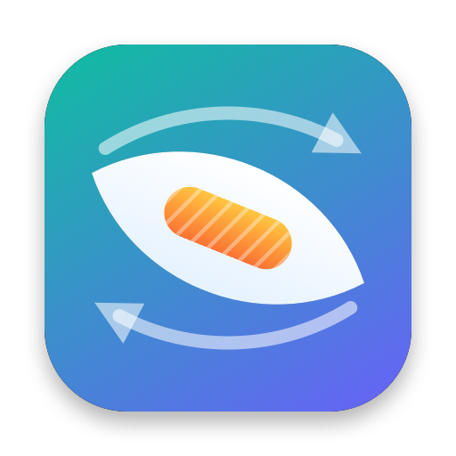
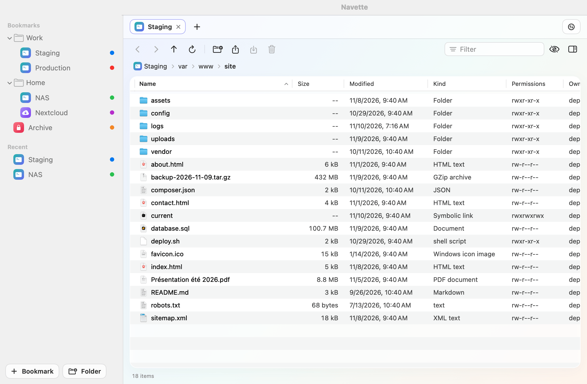
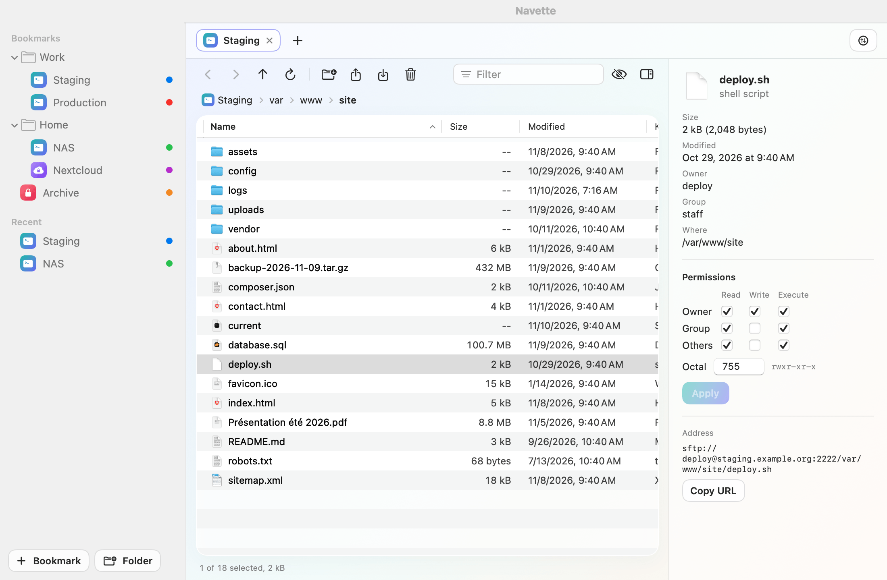
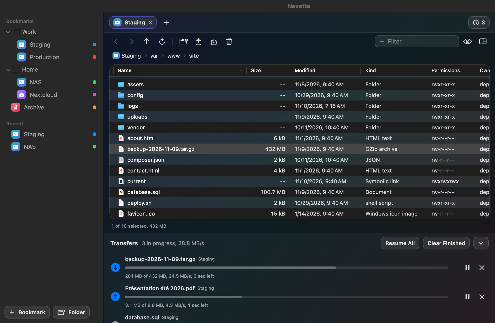
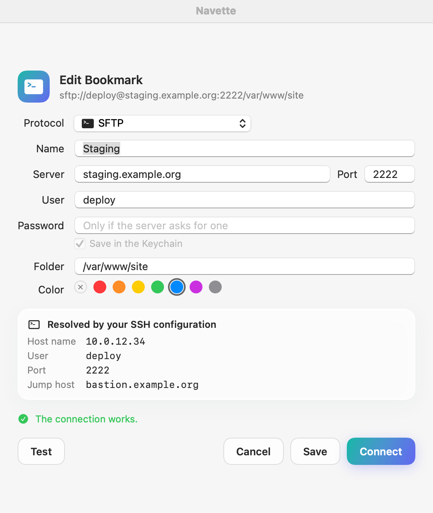
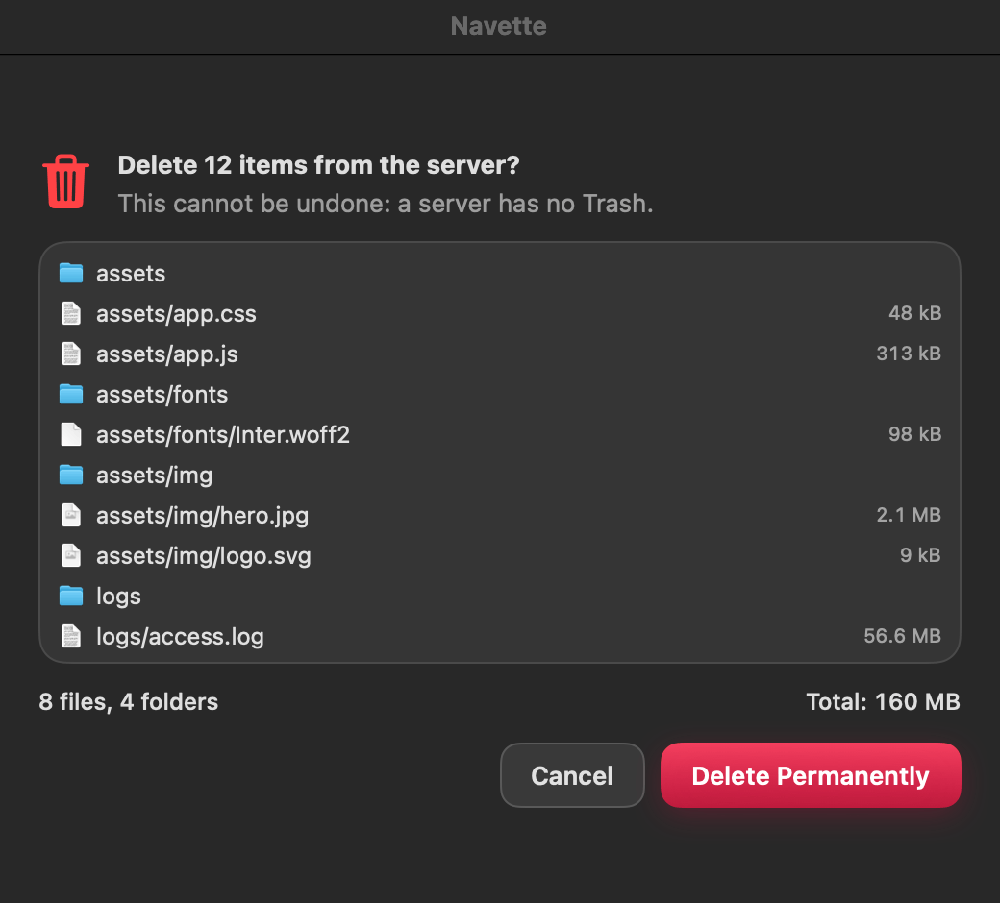

<p align="center"></p>

# Navette

**A free, open-source file transfer client for macOS.** SFTP, FTP, FTPS and WebDAV in a native app that stays fast, keeps your SSH setup as it is, and never deletes or overwrites anything you have not seen.

*[Lire en français](README.fr.md)*

Navette is written in Swift and SwiftUI, weighs about 10 MB, has no third-party dependency and sends no usage data. It is the third app of a small family, after [Mopster](https://github.com/romainrg/Mopster) and Copicol.

> **Status: 0.1.0, not released yet.** The protocol drivers and the transfer engine are covered by automated tests against real local servers. The interface has only been checked through rendered screenshots so far: see [Known limitations](#known-limitations).



## Features

- **File browser**: sortable columns, path bar, filter, hidden files, tabs (one per connection), inspector.
- **Transfers**: a queue with progress, speed and time left; pause, resume, retry and cancel; a speed limit; several transfers at once per server.
- **Conflicts made explicit**: when a file already exists you choose between overwrite, resume, rename and skip, once or for the whole transfer.
- **Drag and drop**: drop files and folders from Finder to upload them; drag from the list to Finder to download them.
- **Bookmarks** with folders and colors, recent connections, passwords in the Keychain.
- **Quick Connect**: paste `sftp://user@host:2222/path` and you are in.
- **Quick Look** on remote files (space bar), and **Open With**: edit a remote file in your editor, each save is sent back.
- **Permissions**: checkboxes and octal, optionally applied to everything inside a folder.
- **English and French.**

| | |
|---|---|
|  |  |
|  |  |

## Protocols

| Protocol | How | Notes |
|---|---|---|
| **SFTP** | The system's own `ssh`, with SFTP spoken over it | Everything in `~/.ssh/config` works: aliases, `Port`, `ProxyJump`, `IdentityFile`, certificates, agents (ssh-agent, 1Password, Secretive), FIDO keys, `known_hosts` |
| **FTP** | Network.framework | Not encrypted: Navette says so |
| **FTPS** | Explicit TLS (`AUTH TLS`), implicit on port 990 | Never falls back to clear text |
| **WebDAV** | URLSession, http and https | Presets for Nextcloud and ownCloud |

S3 and compatible services, a dual pane and folder synchronization are planned for 0.2: see the [roadmap](#roadmap).

### SSH, the way your terminal does it

Navette does not contain an SSH implementation. It runs `/usr/bin/ssh` and lets it do what it already does for you in Terminal. The connection sheet shows what your configuration resolves to (real host name, user, port, keys, jump host) before you connect. When `ssh` needs a password, a passphrase, a one-time code or your decision about a new host key, Navette shows the question in a sheet.

## What Navette never does

- **Delete on a server without showing the list.** A server has no Trash. Before a remote deletion, Navette lists everything the selection contains, with the count and the total size, and deletes exactly that list.
- **Delete on your Mac for good.** A local file replaced by a download goes to the Trash.
- **Accept a changed SSH host key.** It explains what happened and how to fix it; `known_hosts` stays yours.
- **Bypass a certificate error silently.** You see the certificate first, and trusting it applies to that exact certificate for that server.
- **Leave a half-written file in place of a good one.** Uploads and downloads go to a temporary name and are renamed once their size is verified. A cancelled transfer leaves nothing behind.
- **Rewrite a file name.** Accents, emoji, spaces and quotes travel byte for byte, in both directions.
- **Follow a symbolic link out of what you selected** when it deletes or downloads a folder.
- **Phone home.** Navette contacts the servers you configure and nothing else.

## Install

Navette is not released yet. Once it is, download `Navette-<version>.dmg` or `.pkg` from the [releases](https://github.com/romainrg/Navette/releases) page.

The builds are signed ad hoc and not notarized, so macOS blocks the first launch: open **System Settings > Privacy & Security** and click **Open Anyway**. For the same reason, macOS asks once for access to Navette's Keychain item after each update.

Requires macOS 14 or later, on Apple Silicon or Intel.

### Build from source

```sh
brew install xcodegen
make run      # build and open the app
make demo     # try it with sample servers: no network, no disk access
```

Xcode 16 or later is required.

## Known limitations

- **Tested by automated tests only.** Drag and drop, Quick Look, Open With, the prompts and real-world servers still need hands-on testing.
- **FTPS servers that require TLS session reuse** on data connections (the default of vsftpd and FileZilla Server) are not supported: Apple's public API offers no way to do it. Navette explains which server setting is involved.
- **Password and one-time-code prompts over SSH**, FIDO keys and third-party agents rely on `ssh` itself and have not been exercised against real servers yet.
- **No column view, no Bonjour discovery, no Quick Open** in 0.1.
- **Dragging inside the list** to move files is not available; use Rename or your server's tools.
- **WebDAV uploads cannot resume**; they start over.
- **A transfer interrupted by quitting the app** does not resume after relaunch.

## Privacy

Navette has no analytics, no telemetry and no update check. It opens network connections only to the servers you configure. Passwords and passphrases are stored in your Keychain, in a single item named Navette; bookmarks are stored without any secret in `~/Library/Application Support/Navette/bookmarks.json`.

## Development

```sh
make test          # unit tests, then the check that every string has a French translation
make integration   # drivers against local servers started for the occasion (sshd, Apache, vsftpd)
make screenshots   # re-render the images of this README from demo data
make release       # universal build, DMG and PKG in build/release
```

All the logic lives in the `NavetteCore` package, without SwiftUI or AppKit. See [docs/ARCHITECTURE.md](docs/ARCHITECTURE.md), [CONTRIBUTING.md](CONTRIBUTING.md) and, for coding agents, [AGENTS.md](AGENTS.md).

## Roadmap

- **0.2**: S3 and compatible services (AWS, Cloudflare R2, Backblaze B2, Wasabi, MinIO, Scaleway, OVH, Hetzner), dual pane Mac / server, folder synchronization with a preview, import of Cyberduck, Transmit and FileZilla bookmarks, column view, Bonjour, Quick Open.
- **0.3**: Azure Blob, Google Cloud Storage, OpenStack Swift, SMB, Cryptomator vaults.
- **Later**: Developer ID signing and notarization.

## License

[MIT](LICENSE). © 2026 Romain Gallien.
